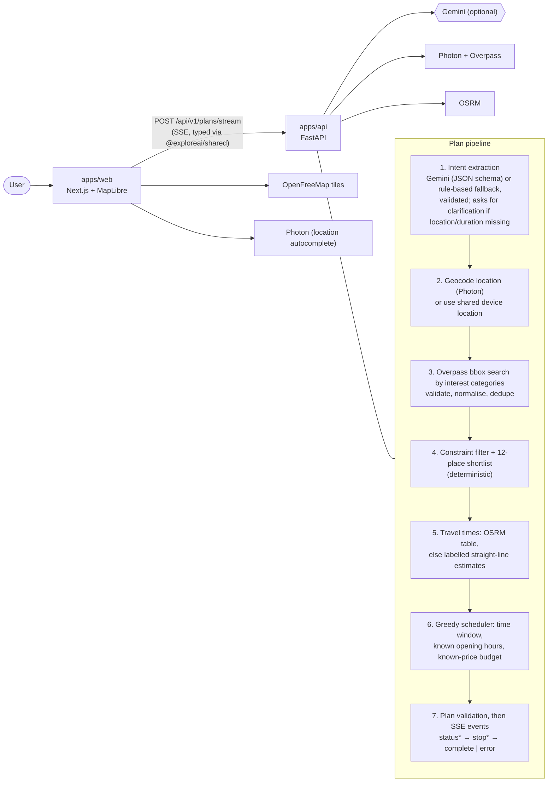

# ExploreAI

Type "I have ₹500 and 3 hours, alone, want something relaxing nearby" and get a timed, costed, mapped itinerary built **only from real places** (OpenStreetMap). 100% free-tier / open-source stack.

> **Status (2026-10-11):** prompt → real places → timed plan → map works end to end against public OSM services. Saving, reloading, revising plans and auth are **not implemented yet** (those endpoints return 501). See [Status](#status) and `docs/project-memory/`.

## How it works



Principles:

- Deterministic Python owns filtering, constraints, costs, scheduling and route validity. The LLM only extracts intent from the prompt and is never the source of truth for places, prices or travel times.
- Never invent venues. Unknown prices, opening hours and travel times stay **unknown** and are labelled as such in the plan (`cost: null`, `budget_status: unverified`, "Price unknown", "estimate" legs, `Plan.notes`).
- Every external response and LLM output is validated; every integration has timeouts, bounded retries, sanitised errors and a graceful fallback.
- Modular monolith: no LangGraph, vector DB, queues or Kubernetes.

## Layout

```
apps/api            FastAPI + Pydantic v2 (uv, ruff, mypy strict, pytest)
  app/main.py         app factory, lifespan, CORS, error handlers
  app/config.py       validated settings (reads root .env)
  app/schemas/        public contract: plans, intent, explanation, errors, health
  app/routers/        HTTP only: health.py, plans.py
  app/services/
    pipeline.py       intent -> builder -> SSE events, overall timeout
    llm/              Gemini provider, prompt, extractor, rule-based fallback
    planning/         http, geocoding (Photon), places (Overpass), facts (hours/prices),
                      routing (OSRM + estimates), scheduler, builder, factory
    explain.py        validated plan explanations (not wired to a route yet)
    readiness.py      /ready checks
  tests/              pytest; all provider traffic mocked (no network, no real .env)
apps/web            Next.js 15, React 19, Tailwind v4, shadcn/ui, MapLibre, TanStack Query, zod
  src/app/            routes: /, /plan/[id], /saved, /login, /design (internal showcase)
  src/components/     home, plan, layout, ui, motion
  src/lib/            sse.ts (SSE parser), plan-stream.ts (reducer), api client, format, geocode
  e2e/                Playwright specs (API mocked)
packages/shared     openapi.json + schema.d.ts generated from the FastAPI app
infra               docker-compose (postgres+postgis, redis, api, web) + postgres/init.sql
scripts             generate-types.mjs (--check mode for CI)
docs/project-memory brief, architecture, decisions, implementation status, next task
.github/workflows   ci.yml (api job + web job)
```

## Prerequisites

[uv](https://docs.astral.sh/uv/) (it provides Python 3.12; system Python 3.10 will not work), Node 20.11+ with corepack (`corepack enable` for pnpm 9). Docker, Postgres and Redis are **not** needed to run the planner today (no DB/Redis client exists yet). `make` is optional; on Windows use the commands below.

## Run locally (Windows, PowerShell)

```powershell
copy .env.example .env          # then set HTTP_USER_AGENT to a real contact (email or URL)
pnpm install                    # repo root
cd apps\api; uv sync --frozen   # creates .venv with Python 3.12
uv run uvicorn app.main:app --reload --port 8000     # terminal 1: API, docs at http://localhost:8000/docs
pnpm dev                                             # terminal 2 (repo root): web at http://localhost:3000
```

A plan typically takes 20–40 s; almost all of it is the public Overpass call. Overpass sometimes returns 504s: the plan then ends with "Place data is temporarily unavailable" (never with invented data). Just retry.

Environment variables (all in `.env.example`, which documents each one):

| Variable | Needed? | Notes |
| --- | --- | --- |
| `HTTP_USER_AGENT` | **yes** | Sent on every outbound call; Overpass/Photon policies require a real contact |
| `CORS_ORIGINS` | defaults to `http://localhost:3000` | must include the web origin; `*` is rejected |
| `NEXT_PUBLIC_API_URL` | defaults to `http://localhost:8000` | must match the API origin |
| `NEXT_PUBLIC_MAP_STYLE_URL` | optional | defaults to OpenFreeMap "liberty" |
| `GEMINI_API_KEY`, `GEMINI_MODEL` | optional | blank = rule-based intent parsing (English, regex; lower recall). Never exercised live yet |
| `OVERPASS_URL`, `PHOTON_URL`, `OSRM_URL` | optional | public instances by default; the public OSRM demo only serves driving |
| `OSRM_WALK_URL` / `OSRM_BIKE_URL` | optional | blank = walking/cycling legs are straight-line **estimates**, labelled as such |
| `PLAN_UTC_OFFSET_MINUTES` | optional | 330 (India) default; plans start "now" in this fixed offset (no DST/tz database) |
| `PLANNER_ENABLED`, `PIPELINE_TIMEOUT_SECONDS`, `OVERPASS_MAX_ELEMENTS` | optional | planner on/off, whole-request budget (120 s), Overpass result cap |
| `HTTP_TIMEOUT_SECONDS`, `HTTP_MAX_RETRIES`, `LLM_TIMEOUT_SECONDS`, `LLM_MAX_RETRIES` | optional | bounded timeouts/retries for outbound calls |
| `DATABASE_URL`, `REDIS_URL`, `GROQ_*`, `OPENROUTER_*`, `OLLAMA_*`, `ORS_API_KEY`, `OPEN_METEO_URL`, `NOMINATIM_URL` | not used yet | reserved for planned features |

The API reads the root `.env`. Next.js only loads `.env*` files from `apps/web`, so `NEXT_PUBLIC_*` values in the root `.env` are NOT picked up by `pnpm dev`; the code defaults match the example values, so you only need an `apps/web/.env.local` if you change them.

**"We couldn't reach the planner"**: the browser could not connect to the API at all. Check the API terminal is running, then check the port: `NEXT_PUBLIC_API_URL` is baked in when `pnpm dev` starts, and a variable left in that shell overrides the default (and any `.env.local`). In dev the message names the URL it tried. Fix: `Remove-Item Env:NEXT_PUBLIC_API_URL` (or open a fresh terminal), then restart `pnpm dev`.

## API (all under `/api/v1`)

| Endpoint | State |
| --- | --- |
| `GET /health`, `GET /ready` | work |
| `POST /plans/stream` | works: SSE stream of `PlanStreamEvent` (`status`, `stop`, `complete`, `error`); steps `understanding → finding_places → scoring → checking_routes → writing` |
| `GET /plans/{id}`, `GET /plans/saved`, `POST /plans/{id}/save`, `POST /plans/{id}/revise/stream` | **501** (not implemented) |
| `POST /auth/login`, `POST /auth/logout`, `GET /auth/me` | **501** (not implemented) |

Errors use one envelope: `{detail: str, code, request_id, errors?}`. Every response carries an `X-Request-ID`.

## Checks

| Where | Command |
| --- | --- |
| `apps/api` | `uv run --frozen pytest -q` · `uv run --frozen ruff check .` · `uv run --frozen ruff format --check .` · `uv run --frozen mypy .` |
| repo root | `pnpm typecheck` · `pnpm lint` · `pnpm test` (vitest) · `pnpm types:check` |
| e2e | `pnpm --filter @exploreai/web test:e2e` (Playwright, API mocked) |

Last recorded run (2026-10-11): 228 pytest passed, ruff/mypy clean, 54 vitest passed, 22 Playwright passed. CI (`.github/workflows/ci.yml`) runs the same plus `pnpm build`.

With `make` available: `make setup`, `make dev` (full docker stack), `make dev-api`, `make dev-web`, `make test`, `make lint`, `make typecheck`, `make types`, `make types-check`, `make format`.

## Shared types workflow

`scripts/generate-types.mjs` exports the schema from the FastAPI app object (`apps/api/scripts/export_openapi.py`, no server needed) to `packages/shared/openapi.json`, then runs `openapi-typescript` to produce `packages/shared/src/schema.d.ts`. Change an API model, run `pnpm types`, keep both files. `pnpm types:check` (CI) fails if they drift.

## Web app (apps/web)

Routes: `/` (prompt composer, location chip, example cards), `/plan/[id]` (streamed result; `/plan/new` is the transient URL while streaming), `/saved`, `/login`. The home page stores the request in sessionStorage; `/plan/new` streams it over SSE with `fetch` (`src/lib/sse.ts`), reduces events with the pure reducer in `src/lib/plan-stream.ts`, and renders a timeline plus a MapLibre map. The contract lives in `apps/api/app/schemas/`.

Playwright runs against `next dev`; `playwright.config.ts` caps local runs at 2 workers because more saturated the single dev server and tests timed out at random. The PWA service worker only registers in production builds.

## Status

Works: intent extraction (Gemini or rule fallback), clarification for missing/ambiguous locations, Photon geocoding, Overpass place search, opening-hours/price parsing (unknown stays unknown), OSRM or labelled-estimate travel legs, deterministic scheduling, SSE streaming, timeline + map UI.

Not yet:

- Plan persistence, GET/save/revise and auth (the UI shows Save / Cheaper / Swap / Add buttons, but they hit 501; reloading `/plan/{id}` loses the plan).
- No cache: identical Photon/Overpass queries are repeated (next task: in-process TTL cache + Overpass fallback URL).
- Postgres/Redis containers exist but nothing talks to them. Only Gemini of the LLM chain is implemented, and never verified live.
- Ranking is interest category + distance (OSM has no ratings); visit lengths are per-category assumptions, disclosed in `Plan.notes`.

Detailed history, decisions and the next task: `docs/project-memory/` (`NEXT_SESSION.md`, `IMPLEMENTATION_STATUS.md`, `DECISIONS.md`, `ARCHITECTURE.md`, `PROJECT_BRIEF.md`).

## Usage-policy notes

Every outbound request sends `HTTP_USER_AGENT`. Public Overpass/Photon/Nominatim/OSRM instances are for light use: respect rate limits (Nominatim ≤1 req/s, no autocomplete), cache aggressively, and self-host before heavy traffic. The UI must show © OpenStreetMap contributors and map-tile attribution.
